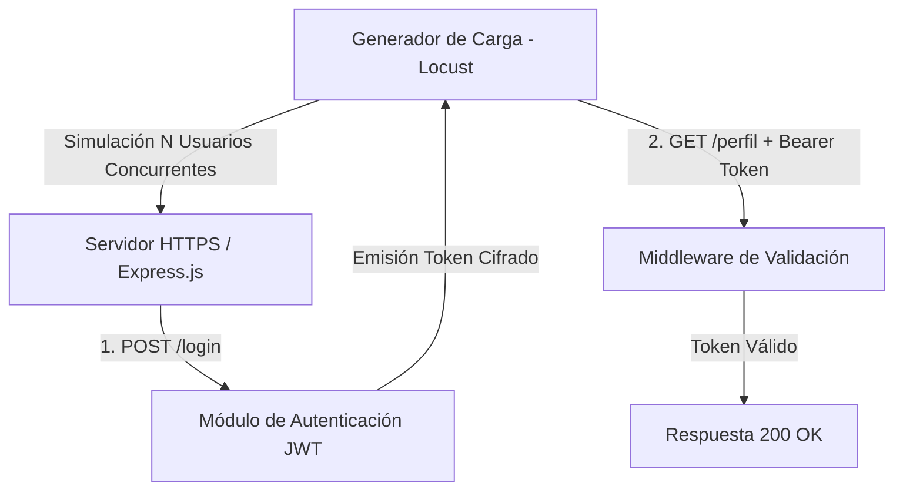
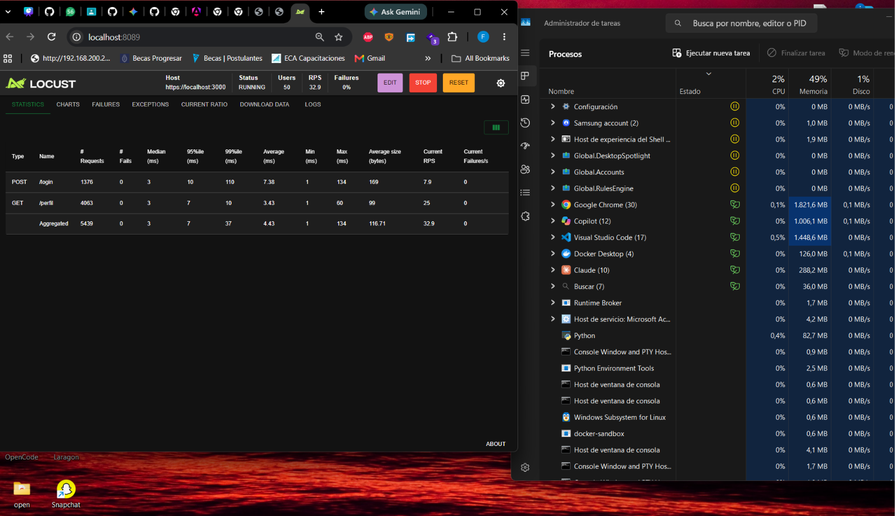

# Trabajo Práctico N° 10: Monitoreo, Pruebas de Carga y Evaluación de Desempeño

**Cátedra:** Desarrollo de Aplicaciones para Ambientes Distribuidos  
**Docente:** Lic. Gabriel Artaza  
**Unidad Temática:** Unidad 4 - Evaluación del Desempeño, Monitoreo y Optimización  
**Modalidad de Entrega:** Estrictamente Individual  
**Formato de Evaluación:** Evaluación de Repositorio + Demostración/Ejecución en Vivo al Cierre del Cursado  

---

## 1. Carátula e Identificación

* **Nombre y Apellido:** Jorge Facundo Díaz
* **Materia:** Desarrollo de Aplicaciones para Ambientes Distribuidos
* **Lenguaje utilizado:** JavaScript
* **Framework:** Express.js
* **Protocolo:** HTTPS (TLS/SSL)
* **Autenticación:** JWT (JSON Web Token)
* **Herramienta de carga:** Apache Locust
* **Sistema Operativo:** Windows 11
* **Herramientas utilizadas:** Node.js, Express, JWT, HTTPS, Locust, Administrador de Tareas de Windows

---

## 2. Objetivo del Trabajo

El objetivo de este trabajo práctico consiste en evaluar el comportamiento de una aplicación distribuida sometida a diferentes niveles de carga mediante la generación controlada de usuarios concurrentes.

Para ello se utilizaron pruebas de carga y estrés sobre el servidor HTTPS desarrollado en el Trabajo Práctico N° 9, el cual implementa autenticación basada en JWT.

Se analizaron las siguientes métricas:
* Tiempo de respuesta (latencia)
* Throughput (peticiones por segundo)
* Porcentaje de errores
* Consumo de CPU
* Consumo de memoria RAM

---

## 3. Descripción del Servicio Evaluado

Se reutilizó el servidor desarrollado en el **TP9**. La aplicación implementa:
* Comunicación segura mediante **HTTPS**.
* Autenticación mediante **JWT**.
* Middleware de validación de tokens.
* Control de acceso a rutas protegidas.

### Endpoints evaluados

* **Login (`POST /login`):** Permite autenticar usuarios y generar tokens JWT.
* **Perfil protegido (`GET /perfil`):** Permite acceder a información protegida validando previamente el token JWT.

---

## 4. Arquitectura Evaluada



---

## 5. Entorno de Ejecución

### Hardware
* **Procesador:** Intel Core i5
* **Memoria RAM:** 8 GB
* **Almacenamiento:** SSD

### Software
* Windows 11
* Node.js
* Express.js
* Locust `2.47.0`
* Python `3.14.4`

---

## 6. Herramienta Utilizada para las Pruebas

Se seleccionó **Locust** como generador de carga debido a su facilidad para simular usuarios concurrentes mediante scripts escritos en Python.

* **Archivo utilizado:** `locustfile.py`

### Escenario implementado
Cada usuario virtual ejecuta secuencialmente:
1. Realiza autenticación mediante:
   ```http
   POST /login
   ```
2. Obtiene un token JWT.
3. Accede repetidamente a:
   ```http
   GET /perfil
   ```
   utilizando dicho token en el encabezado `Authorization`.

---

## 7. Configuración de las Pruebas

### Prueba de Carga
* **Usuarios concurrentes:** 50
* **Spawn Rate:** 5 usuarios/segundo
* **Duración:** 3 minutos
* **Objetivo:** Evaluar el comportamiento normal del sistema bajo una carga moderada.

### Prueba de Estrés
* **Usuarios concurrentes:** 200, 500 y 1000 usuarios
* **Objetivo:** Incrementar progresivamente la carga hasta detectar síntomas de degradación o saturación.

---

## 8. Evidencias de Ejecución

### Captura 1 - Inicio de Prueba con Locust

* **Descripción:** Configuración inicial de Locust especificando cantidad de usuarios concurrentes y velocidad de generación.

### Captura 2 - Prueba de Carga (50 Usuarios)

* **Resultados observados:**
  * 0% de errores.
  * Tiempo de respuesta promedio inferior a 10 ms.
  * Funcionamiento altamente estable.

### Captura 3 - Prueba de Estrés (500 Usuarios)

* **Resultados observados:**
  * Leve incremento de latencia.
  * 0% de errores.
  * Throughput superior a 300 requests/segundo.

### Captura 4 - Prueba de Estrés (1000 Usuarios)

* **Resultados observados:**
  * Throughput superior a 660 requests/segundo.
  * 0% de errores.
  * Incremento considerable de la latencia en el endpoint `/login`.

### Captura 5 - Monitoreo del Sistema

* **Descripción:** Monitoreo del consumo de CPU y memoria RAM durante la ejecución de las pruebas mediante el Administrador de Tareas.

---

## 9. Tabla Comparativa de Resultados

| Usuarios Concurrentes | Tiempo Promedio (Latencia) | Throughput (Req/sec) | Error Rate (%) |
| :---: | :---: | :---: | :---: |
| **50** | 4.43 ms | 32.9 req/s | 0% |
| **200** | 9.76 ms | 131.6 req/s | 0% |
| **500** | 17.76 ms | 335.6 req/s | 0% |
| **1000** | 217.64 ms | 660.7 req/s | 0% |

---

## 10. Análisis de Resultados

Durante las pruebas se observó una relación directa entre el incremento de usuarios concurrentes y el aumento de la latencia:
* Con **50 usuarios**, el sistema respondió de forma prácticamente instantánea.
* Al aumentar a **500 usuarios concurrentes**, comenzaron a registrarse tiempos de respuesta más elevados, principalmente en el endpoint de autenticación (`/login`), debido al procesamiento requerido para la generación y firma de tokens JWT.
* Con **1000 usuarios concurrentes**, el servicio continuó funcionando sin registrar errores, aunque se observó un incremento considerable en los tiempos máximos de respuesta, alcanzando varios segundos en algunos casos extremos.

---

## 11. Cuello de Botella Detectado

El principal cuello de botella identificado fue el **proceso de autenticación** (`POST /login`).

Cada solicitud a este endpoint requiere:
1. Validación de credenciales del usuario.
2. Generación del payload JWT.
3. Firma criptográfica del token.
4. Procesamiento de cifrado en la capa de transporte HTTPS (TLS/SSL).

En contraste, el endpoint `GET /perfil` presentó tiempos significativamente menores debido a que únicamente requiere verificar la firma de un token ya emitido.

---

## 12. Propuestas de Optimización

Se proponen las siguientes mejoras para optimizar la escalabilidad del sistema:
* **Balanceo de carga:** Incorporar NGINX o HAProxy como proxy inverso.
* **Escalabilidad horizontal:** Desplegar múltiples instancias del servicio Node.js utilizando PM2 en modo *cluster* o Docker Containers.
* **Optimización de autenticación:** Implementar caché distribuido (ej. Redis) para tokens activos si se requiriera validación de listas de revocación.
* **Monitoreo continuo:** Incorporar exportación de métricas mediante Prometheus y visualización en tiempo real con Grafana.
* **Control de tasa (Rate Limiting):** Implementar middleware de *rate limiting* para proteger los endpoints contra ataques de denegación de servicio (DoS).

---

## 13. Estructura del Proyecto

```text
TP10/
│
├── servidor/
│   ├── cert/
│   ├── middleware/
│   ├── server.js
│   ├── package.json
│   └── node_modules/
│
├── locustfile.py
│
├── evidencias/
│   ├── carga_50_usuarios.png
│   ├── estres_500_usuarios.png
│   ├── estres_1000_usuarios.png
│   └── monitor_cpu_ram.png
│
└── README.md
```

---

## 14. Conclusiones

Durante el desarrollo de este trabajo práctico se llevaron a cabo pruebas de carga y estrés sobre una aplicación distribuida desarrollada con Express.js, protegida mediante HTTPS (TLS/SSL) y autenticación basada en JSON Web Token (JWT).

Las pruebas permitieron analizar métricas fundamentales de rendimiento, tales como latencia, throughput (peticiones por segundo), tasa de errores y utilización de recursos del sistema. Para ello se utilizó la herramienta Locust, simulando distintos niveles de concurrencia de usuarios sobre los endpoints de autenticación y acceso protegido.

Los resultados obtenidos demostraron que el sistema mantiene un comportamiento estable bajo condiciones normales de operación, soportando correctamente 50 usuarios concurrentes sin registrar errores y con tiempos de respuesta reducidos.

Posteriormente se realizaron pruebas de estrés incrementando la carga hasta 200, 500 y 1000 usuarios concurrentes. A pesar del incremento significativo de solicitudes, el servicio mantuvo una tasa de errores del 0%, sin presentar interrupciones ni fallos de disponibilidad.

No obstante, se observó un aumento considerable en la latencia del endpoint `/login`, especialmente en la prueba de 1000 usuarios concurrentes. Este comportamiento evidencia que el proceso de generación y firma de tokens JWT, junto con el procesamiento de conexiones HTTPS, constituye el principal punto de degradación del rendimiento de la aplicación.

Además, durante la generación de carga máxima, la herramienta Locust emitió advertencias relacionadas con un elevado consumo de CPU en el propio generador de tráfico, indicando que la herramienta comenzaba a acercarse a sus límites operativos antes de que el servidor presentara errores o caídas.

Como conclusión final, se identificó que el sistema presenta una alta capacidad de respuesta y escalabilidad para el escenario evaluado, siendo el tiempo de respuesta del mecanismo de autenticación el principal cuello de botella detectado. Como trabajo futuro se propone implementar balanceo de carga, múltiples instancias del servicio, optimización del proceso de autenticación y herramientas de monitoreo avanzadas para continuar mejorando el rendimiento y la escalabilidad de la arquitectura.