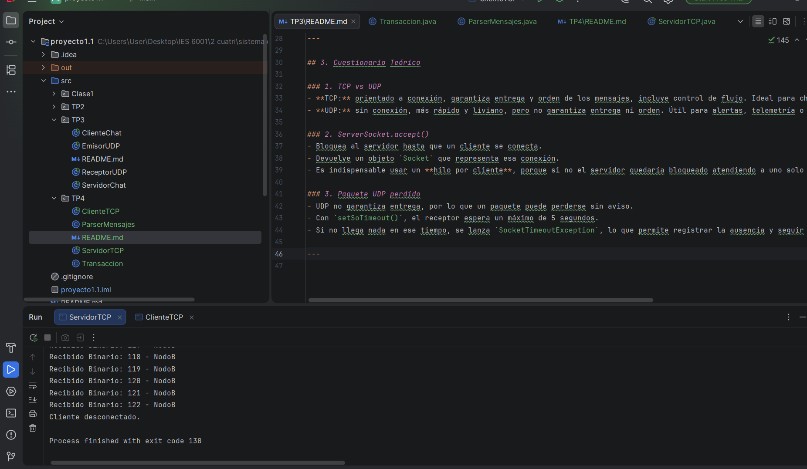
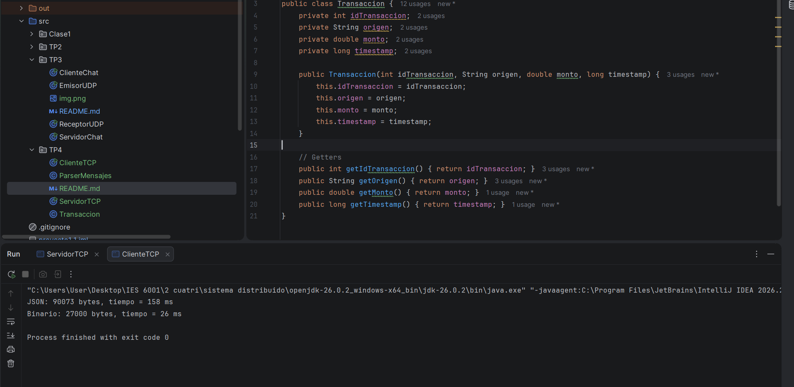

# Trabajo Práctico N°4 – Representación de Datos y Paso de Mensajes

**Asignatura:** Desarrollo de Aplicaciones para Ambientes Distribuidos  
**Docente:** Lic. Gabriel Artaza

---

## 1. Objetivo
Comprender e implementar el empaquetado, serialización/deserialización (marshalling/unmarshalling) y transmisión de estructuras de datos complejas entre procesos a través de un canal de red Socket TCP.

---

## 2. Resultados de Desempeño

| Formato | Tamaño total (bytes) | Tiempo total (ms) |
|---------|----------------------|-------------------|
| JSON    | 90073                | 158               |
| Binario | 27000                | 26                |

### Observaciones
- El formato **Binario** ocupa menos espacio y se transmite más rápido.
- El formato **JSON** es más legible y portable, pero introduce overhead en tamaño y tiempo.

---

## 3. Capturas de Pantalla
- **Servidor recibiendo transacciones JSON y Binario.**
- **Cliente mostrando resultados de bytes y tiempos.**

