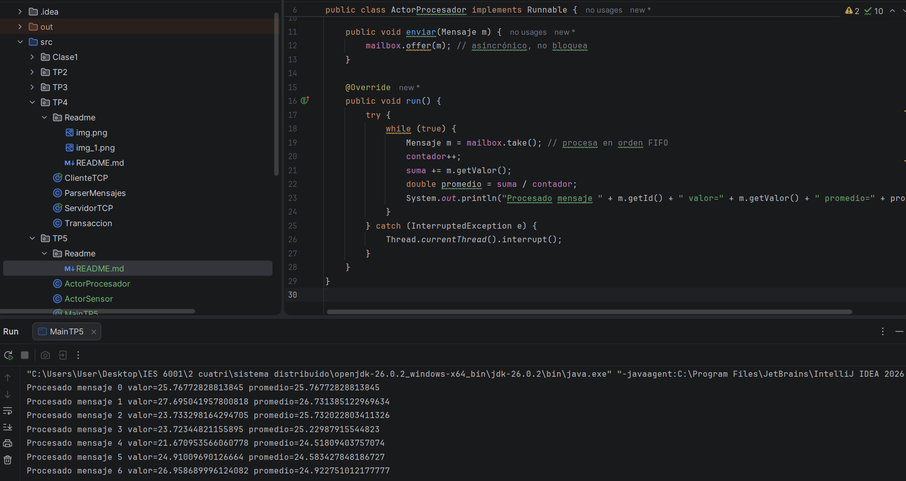

# Trabajo Práctico N°5 – Concurrencia y Sincronización con el Modelo de Actores

**Asignatura:** Desarrollo de Aplicaciones para Ambientes Distribuidos  
**Docente:** Lic. Gabriel Artaza  
**Modalidad:** Individual

---

## 1. Objetivo
Comprender e implementar los principios del **Modelo de Actores** para la resolución de problemas de concurrencia y sincronización mediante el paso de mensajes asincrónicos, eliminando la necesidad de memoria compartida y bloqueos (`synchronized` / `locks`).

---

## 2. Arquitectura de Actores

- **ActorSensor:** genera lecturas métricas (ejemplo: temperatura) y las envía como mensajes inmutables.
- **ActorProcesador:** recibe los mensajes en su buzón FIFO, los procesa secuencialmente y mantiene un contador/promedio histórico privado.

---
## 3. Evidencia de Ejecución

### Captura de pantalla – MainTP5
La siguiente imagen muestra la salida en consola del programa, evidenciando el procesamiento secuencial de los mensajes y el cálculo del promedio:
