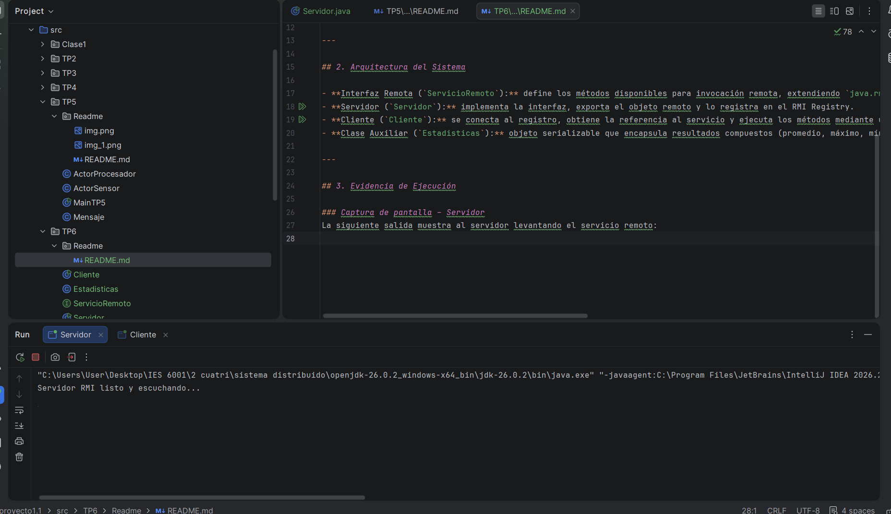
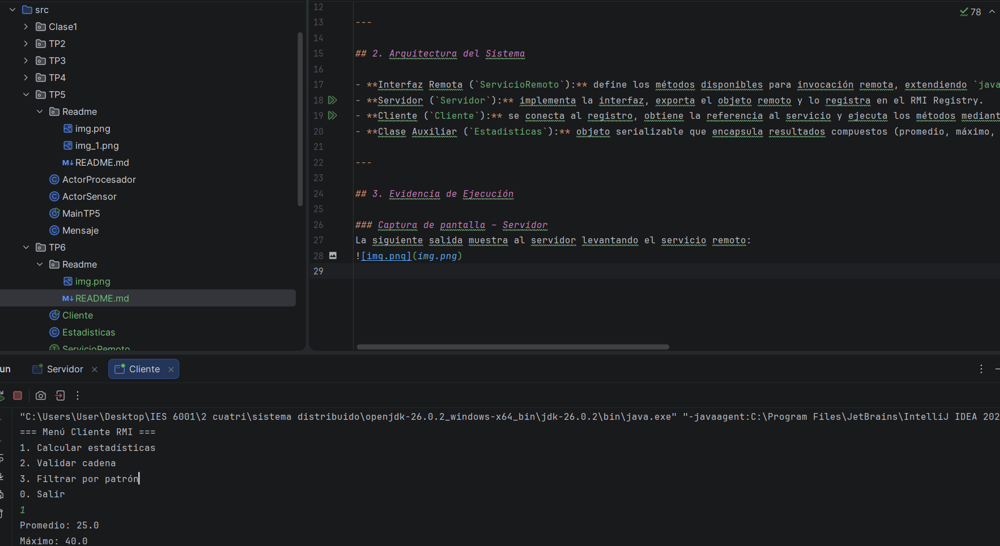

# Trabajo Práctico N°6 – Middleware RMI (Java)

**Asignatura:** Desarrollo de Aplicaciones para Ambientes Distribuidos  
**Docente:** Lic. Gabriel Artaza  
**Modalidad:** Individual

---

## 1. Objetivo
Comprender e implementar los principios del **Middleware RMI (Remote Method Invocation)** para la resolución de problemas de comunicación en sistemas distribuidos, permitiendo la invocación de métodos remotos como si fueran locales.  
El objetivo es experimentar la **transparencia de localización**, el ciclo de vida **Stub/Skeleton**, y el manejo de excepciones en entornos distribuidos.

---

## 2. Arquitectura del Sistema

- **Interfaz Remota (`ServicioRemoto`):** define los métodos disponibles para invocación remota, extendiendo `java.rmi.Remote`.
- **Servidor (`Servidor`):** implementa la interfaz, exporta el objeto remoto y lo registra en el RMI Registry.
- **Cliente (`Cliente`):** se conecta al registro, obtiene la referencia al servicio y ejecuta los métodos mediante un menú interactivo.
- **Clase Auxiliar (`Estadisticas`):** objeto serializable que encapsula resultados compuestos (promedio, máximo, mínimo, desviación).

---

## 3. Evidencia de Ejecución

### Captura de pantalla – Servidor
La siguiente salida muestra al servidor levantando el servicio remoto:

