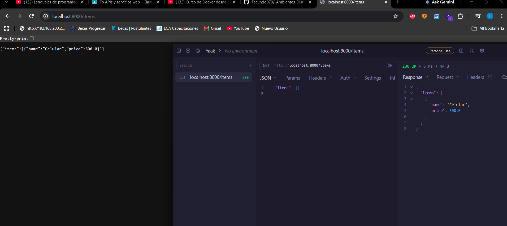
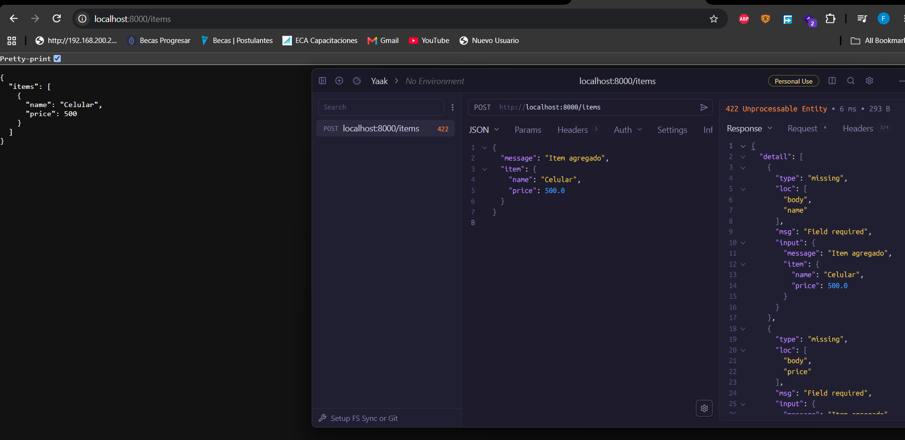

# Trabajo Práctico N° 7  
**Integración entre Capas y Consumo de APIs / Servicios Distribuidos**  

**Cátedra:** Desarrollo de Aplicaciones para Ambientes Distribuidos  
**Docente:** Lic. Gabriel Artaza  
**Unidad Temática:** Unidad 3 - Middleware y Tecnologías de Abstracción Distribuida  
**Modalidad de Entrega:** Estrictamente Individual  
**Formato de Evaluación:** Evaluación de Repositorio + Demostración/Ejecución en Vivo al Cierre del Cursado  

---

## 1. Carátula e Identificación
- **Nombre y Apellido:** Jorge Facundo Díaz  
- **Materia:** Desarrollo de Aplicaciones para Ambientes Distribuidos  
- **Lenguaje y Framework utilizados:** Python + FastAPI (Servidor), Python + Requests (Cliente), Docker + Docker Compose  

---

## 2. Diagrama de Arquitectura
El siguiente diagrama ilustra la interacción distribuida entre la capa cliente, el canal de comunicación HTTP y el servidor de servicios:

```mermaid
graph TD
    subgraph Contenedor Cliente
        A[cliente.py] -->|Genera peticiones HTTP| B[Librería Requests]
    end

    B -->|HTTP/1.1 (JSON) <br/> Red Docker Bridge| C[Servidor API FastAPI]

    subgraph Contenedor Servidor
        C -->|Procesa Endpoints| D[main.py / /items]
    end

---

## 3. Evidencias de Ejecución (Capturas de Pantalla)

  
  

---

## 4. Instrucciones de Ejecución

1. **Clonar el repositorio:**
   ```bash
   git clone https://github.com/Facundo070/-Ambientes-Distribuidos-6001.git
   ```

2. **Ubicarse en la carpeta TP7:**
   ```bash
   cd src/TP7
   ```

3. **Levantar los servicios con Docker Compose:**
   ```bash
   docker-compose up --build
   ```

4. **Probar el servidor:**
   - **GET:** `http://localhost:8000/items`
   - **POST:** Enviar payload JSON (por ejemplo con Postman o cURL) a `http://localhost:8000/items`

5. **Ejecución del Cliente:**
   - El cliente (`cliente.py`) se ejecuta automáticamente en su propio contenedor y muestra las respuestas de la API directamente en la consola.

---

## 5. Estructura del Repositorio

```text
TP7/
 ├── servidor/
 │    ├── main.py
 │    └── Dockerfile
 ├── cliente/
 │    ├── cliente.py
 │    └── Dockerfile
 ├── docker-compose.yml
 └── README.md
```