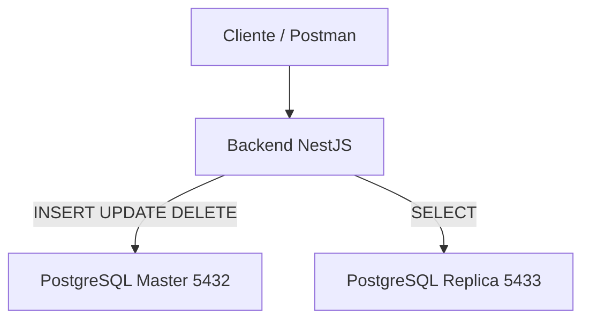
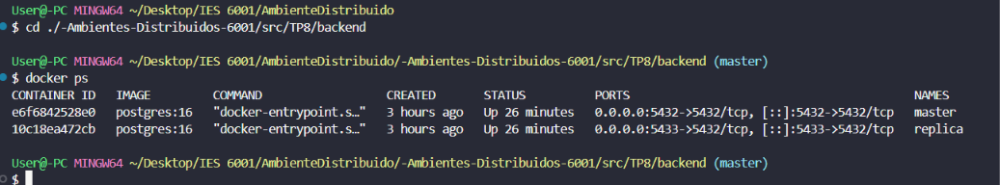
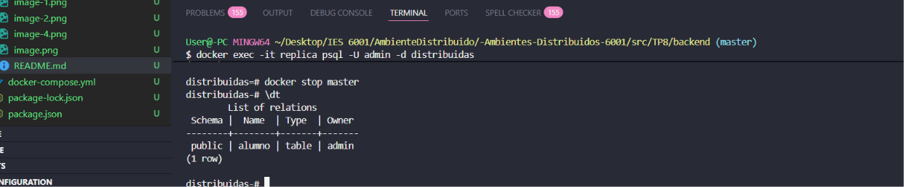
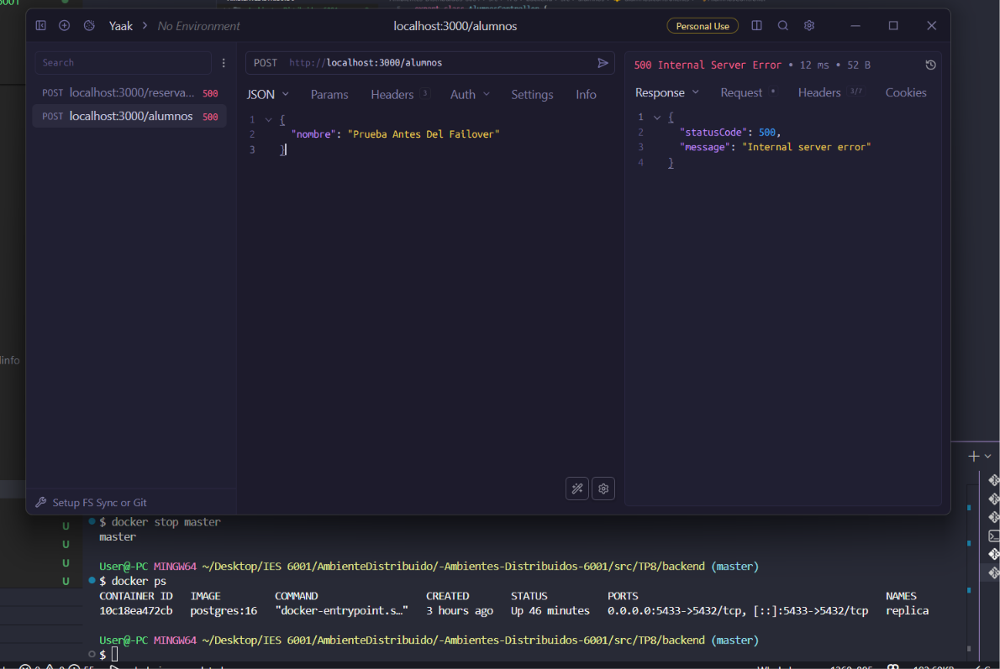

# Trabajo Práctico N° 8
## Bases de Datos Distribuidas y Conexión entre Capas

**Cátedra:** Desarrollo de Aplicaciones para Ambientes Distribuidos  
**Docente:** Lic. Gabriel Artaza  
**Unidad Temática:** Unidad 4 - Bases de Datos Distribuidas y Conexión entre Capas  
**Modalidad de Entrega:** Estrictamente Individual  
**Formato de Evaluación:** Evaluación de Repositorio + Demostración/Ejecución en Vivo al Cierre del Cursado

---

## 1. Carátula e Identificación

- **Nombre y Apellido:** Jorge Facundo Díaz
- **Materia:** Desarrollo de Aplicaciones para Ambientes Distribuidos
- **Lenguaje y Framework utilizados:** TypeScript + NestJS
- **Base de Datos:** PostgreSQL
- **ORM:** TypeORM
- **Infraestructura:** Docker + Docker Compose

---

## 2. Diagrama de Arquitectura

El siguiente diagrama representa la arquitectura implementada para la persistencia distribuida utilizando un nodo principal (Master) y un nodo secundario (Replica).



### Componentes de la Arquitectura

- **NestJS:** Framework utilizado para desarrollar el backend.
- **TypeORM:** ORM encargado del mapeo objeto-relacional.
- **PostgreSQL Master:** Nodo principal utilizado para las operaciones de escritura.
- **PostgreSQL Replica:** Nodo secundario utilizado como réplica y respaldo.
- **Docker Compose:** Herramienta utilizada para desplegar los servicios.

---

## 3. Evidencias de Ejecución

### Captura 1 - Contenedores en ejecución

Comando ejecutado:

```bash
docker ps
```

Resultado esperado:

```text
master
replica
```

Demostración de que ambos nodos de base de datos se encuentran activos dentro del entorno Docker.

---

### Captura 2 - Inserción de Datos

Petición ejecutada:

```http
POST http://localhost:3000/alumnos
```

Body:

```json
{
  "nombre": "Facundo"
}
```

Respuesta obtenida:

```json
{
  "id": 3,
  "nombre": "Facundo"
}
```

Esta prueba demuestra la escritura exitosa sobre la base de datos.

---

### Captura 3 - Consulta de Datos

Petición ejecutada:

```http
GET http://localhost:3000/alumnos
```

Respuesta obtenida:

```json
[
  {
    "id": 2,
    "nombre": "Facundo"
  }
]
```

Esta prueba demuestra la lectura de los datos almacenados.

---

### Captura 4 - Verificación de la Base de Datos

Ingreso al contenedor:

```bash
docker exec -it master psql -U admin -d distribuidas
```

Consulta ejecutada:

```sql
\dt
```

Resultado observado:

```text
public | alumno | table | admin
```

Esto verifica la creación automática de la tabla mediante TypeORM.

---

### Captura 5 - Simulación de Caída del Nodo Principal

Detención del contenedor principal:

```bash
docker stop master
```

Posteriormente se intentó ejecutar:

```http
POST http://localhost:3000/alumnos
```

Respuesta obtenida:

```json
{
  "statusCode": 500,
  "message": "Internal server error"
}
```

El backend detectó la indisponibilidad del nodo principal y devolvió un error de conexión, demostrando el comportamiento esperado ante una falla del nodo de escritura.

---

## 4. Instrucciones de Ejecución

### Clonar el repositorio

```bash
git clone https://github.com/Facundo070/-Ambientes-Distribuidos-6001.git
```

### Posicionarse en la carpeta del TP

```bash
cd src/TP8
```

### Levantar la infraestructura

```bash
docker compose up -d
```

### Ingresar al Backend

```bash
cd backend
```

### Instalar dependencias

```bash
npm install
```

### Ejecutar la aplicación

```bash
npm run start:dev
```

---

## 5. Endpoints Disponibles

### Crear Alumno

```http
POST http://localhost:3000/alumnos
```

Body:

```json
{
  "nombre": "Facundo"
}
```

---

### Obtener Alumnos

```http
GET http://localhost:3000/alumnos
```

---

## 6. Estructura del Repositorio

```text
TP8/
│
├── backend/
│   ├── src/
│   │   ├── alumnos/
│   │   │   ├── alumno.entity.ts
│   │   │   ├── alumnos.controller.ts
│   │   │   ├── alumnos.service.ts
│   │   │   └── alumnos.module.ts
│   │   │
│   │   ├── app.module.ts
│   │   └── main.ts
│   │
│   ├── package.json
│   ├── tsconfig.json
│   └── node_modules/
│
├── docker-compose.yml
│
└── README.md
```

---

## 7. Tecnologías Utilizadas

- NestJS
- TypeScript
- PostgreSQL
- TypeORM
- Docker
- Docker Compose
- Postman

---

## 8. Conclusiones

Durante el desarrollo de este trabajo práctico se implementó una arquitectura distribuida utilizando PostgreSQL y NestJS sobre contenedores Docker. Se configuró un nodo principal (Master) encargado de las operaciones de escritura y un nodo secundario (Replica) destinado a tareas de respaldo.

Se desarrolló una API REST utilizando NestJS y TypeORM, permitiendo realizar operaciones de inserción y consulta de datos sobre la entidad Alumno. Asimismo, se verificó la correcta persistencia de la información y el acceso a la base de datos desde la aplicación.

Finalmente, se realizó una simulación de caída del nodo principal mediante la detención del contenedor correspondiente. Ante esta situación, el backend detectó la indisponibilidad del servicio de base de datos y devolvió una excepción de error, permitiendo analizar el comportamiento de la aplicación frente a fallos de infraestructura distribuidos.

La experiencia permitió comprender el funcionamiento de la integración entre la capa de aplicación y la capa de persistencia, así como la importancia de la tolerancia a fallas y la distribución de servicios en arquitecturas modernas.