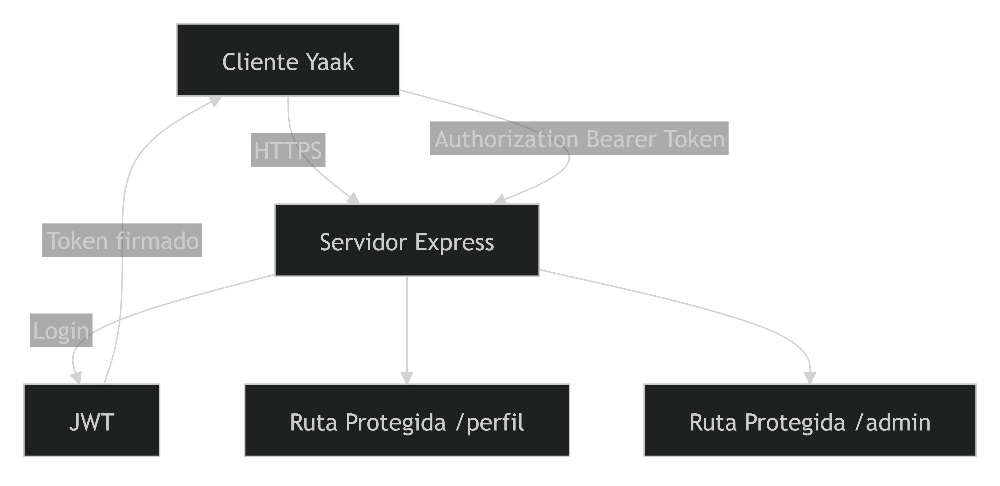
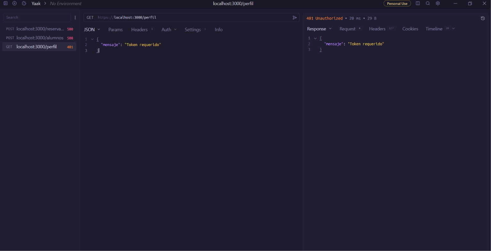

# Trabajo Práctico N° 9: Seguridad en Aplicaciones Distribuidas (JWT y TLS/SSL)

**Cátedra:** Desarrollo de Aplicaciones para Ambientes Distribuidos  
**Docente:** Lic. Gabriel Artaza  
**Unidad Temática:** Unidad 4 - Seguridad en Aplicaciones Distribuidas  
**Modalidad de Entrega:** Estrictamente Individual  
**Formato de Evaluación:** Evaluación de Repositorio + Demostración/Ejecución en Vivo al Cierre del Cursado  

---

## 1. Carátula e Identificación

- **Nombre y Apellido:** Jorge Facundo Díaz  
- **Materia:** Desarrollo de Aplicaciones para Ambientes Distribuidos  
- **Lenguaje utilizado:** JavaScript  
- **Framework:** Express.js  
- **Autenticación:** JSON Web Token (JWT)  
- **Seguridad de Transporte:** HTTPS (TLS/SSL)  
- **Herramientas utilizadas:** Node.js, OpenSSL, Yaak  

---

## 2. Arquitectura de Seguridad

La aplicación implementa una capa de seguridad compuesta por dos mecanismos principales:

1. **TLS/SSL (HTTPS):** Para proteger la comunicación entre cliente y servidor cifrando el canal de transporte.
2. **JWT (JSON Web Token):** Para la autenticación sin estado (*stateless*) y autorización basada en roles (RBAC).

### Diagrama de Arquitectura

```mermaid
graph TD
    Client[Cliente / Yaak / Navegador] -->|1. Petición HTTPS Cifrada TLS/SSL| Server[Servidor Express.js]
    Server -->|2. POST /login Credenciales| Auth[Módulo de Autenticación]
    Auth -->|3. Emisión de Token JWT| Client
    Client -->|4. GET /perfil u /admin + Bearer Token| Middleware[Middleware de Autorización]
    Middleware -->|5. Token Válido & Rol Correcto| Route[Ruta Protegida / Recurso]
    Middleware -->|6. Token Ausente / Alterado| Error401[401 Unauthorized]
    Middleware -->|7. Rol Insuficiente| Error403[403 Forbidden]
    
```

### Componentes principales
- **Express.js:** Framework backend principal utilizado para estructurar las rutas y servicios.
- **HTTPS:** Canal seguro habilitado mediante la carga de certificados SSL/TLS autofirmados.
- **JWT:** Mecanismo de autenticación basado en tokens firmados con una clave secreta.
- **Middleware de Autorización:** Interceptador que valida la existencia, expiración e integridad del token.
- **Control de Roles:** Mecanismo de control de acceso que valida si el usuario posee los permisos requeridos (ej. `admin` vs `user`).

---

## 3. Evidencias de Ejecución

### Captura 1 - Emisión de Token JWT

**Petición ejecutada:**
```http
POST https://localhost:3000/login
Content-Type: application/json
{
  "username": "admin",
  "password": "1234"
}
```

**Respuesta obtenida:**
```json
{
  "token": "eyJhbGciOiJIUzI1Ni..."
}
-Ambientes-Distribuidos-6001/src/TP9/README/Captura de pantalla 2026-11-09 195155.png
```
> **Explicación:** Esta evidencia demuestra la autenticación exitosa del usuario y la emisión de un JWT firmado digitalmente por el servidor.

---

### Captura 2 - Acceso Autorizado mediante HTTPS

**Petición ejecutada:**
```http
GET https://localhost:3000/perfil
Authorization: Bearer <token>
```

**Respuesta obtenida:**
```json
{
  "mensaje": "Acceso autorizado"
}
```
> **Explicación:** Demuestra el acceso exitoso a una ruta protegida utilizando transporte seguro (HTTPS) y enviando un token JWT válido.

---

### Captura 3 - Rechazo por Ausencia de Token

**Petición ejecutada:**
```http
GET https://localhost:3000/perfil
```
*(Sin encabezado `Authorization`)*

**Respuesta obtenida (`401 Unauthorized`):**
```json
{
  "mensaje": "Token requerido"
}
```
> **Explicación:** Esta evidencia demuestra que el middleware de seguridad rechaza automáticamente cualquier solicitud a rutas privadas que carezca de credenciales.

---

### Captura 4 - Detección de Alteración del JWT (Tampering)

Se modificó manualmente el payload del token JWT utilizando la herramienta JWT.io (alterando el rol o nombre de usuario) sin volver a firmarlo con la clave secreta original.

**Petición ejecutada:**
```http
GET https://localhost:3000/perfil
Authorization: Bearer <token_alterado>
```

**Respuesta obtenida (`401 Unauthorized`):**
```json
{
  "mensaje": "Token inválido o expirado"
}
```
> **Explicación:** Esta prueba demuestra que el servidor valida la firma criptográfica del token, detectando cualquier modificación no autorizada en el payload y rechazando la solicitud.

---

### Captura 5 - Control de Acceso por Roles

Se autenticó un usuario con rol estándar:
```json
{
  "rol": "user"
}
```

Posteriormente se intentó acceder al recurso administrativo:
```http
GET https://localhost:3000/admin
Authorization: Bearer <token_usuario_comun>
```

**Respuesta obtenida (`403 Forbidden`):**
```json
{
  "mensaje": "Acceso denegado"
}
```
> **Explicación:** Muestra la correcta implementación del control de acceso basado en roles (RBAC). El token es válido (autenticado), pero carece del rol necesario para ver el recurso (no autorizado).

---

## 4. Instrucciones de Ejecución

1. **Clonar el repositorio:**
   ```bash
   git clone https://github.com/Facundo070/-Ambientes-Distribuidos-6001.git
   ```

2. **Posicionarse en la carpeta del proyecto:**
   ```bash
   cd src/TP9/servidor
   ```

3. **Instalar dependencias necesarias:**
   ```bash
   npm install
   ```

4. **Generar certificados SSL/TLS con OpenSSL:**
   ```bash
   openssl req -x509 -newkey rsa:2048 -nodes -keyout cert/key.pem -out cert/cert.pem -days 365
   ```

5. **Ejecutar la aplicación:**
   ```bash
   node server.js
   ```

6. **Acceder al servidor seguro:**
   ```text
   https://localhost:3000
   ```

---

## 5. Endpoints Disponibles

| Método | Endpoint | Encabezados Required | Descripción |
| :--- | :--- | :--- | :--- |
| `POST` | `https://localhost:3000/login` | `Content-Type: application/json` | Autentica un usuario y genera el JWT |
| `GET` | `https://localhost:3000/perfil` | `Authorization: Bearer <token>` | Acceso a perfil de cualquier usuario autenticado |
| `GET` | `https://localhost:3000/admin` | `Authorization: Bearer <token>` | Requiere token válido con rol `"admin"` |

---

## 6. Estructura del Repositorio

```text
TP9/
├── README/
├── servidor/
│   ├── cert/
│   │   ├── cert.pem
│   │   └── key.pem
│   │
│   ├── middleware/
│   │   └── auth.js
│   │
│   ├── server.js
│   ├── package.json
│   └── node_modules/
│
├── cliente/nada
│
└── README.md
```

---

## 7. Tecnologías Utilizadas

- **Node.js** (Entorno de ejecución para JavaScript)
- **Express.js** (Framework de servidor web)
- **JSON Web Token (JWT)** (Estándar para la transmisión de identidades)
- **HTTPS & TLS/SSL** (Cifrado de la capa de transporte)
- **OpenSSL** (Generación de llaves y certificados digitales)
- **Yaak** (Cliente HTTP para realizar pruebas de endpoints)

---

## 8. Conclusiones

Durante el desarrollo de este trabajo práctico se implementó una capa de seguridad completa sobre una aplicación distribuida utilizando HTTPS y JSON Web Tokens.

Se configuró un canal seguro mediante certificados SSL/TLS, permitiendo cifrar toda la comunicación entre cliente y servidor. Asimismo, se desarrolló un mecanismo de autenticación basado en JWT capaz de emitir tokens firmados digitalmente, incorporando información sobre identidad, rol y expiración.

Además, se implementó un middleware encargado de validar la autenticación de los usuarios y proteger recursos sensibles. Se verificó el correcto funcionamiento de los códigos de respuesta HTTP `401 Unauthorized` y `403 Forbidden` ante intentos de acceso no autorizados.

Finalmente, se llevó a cabo una prueba de tampering mediante la modificación manual del payload de un token JWT, comprobando que el servidor detecta automáticamente cualquier alteración de la firma y rechaza la solicitud.

La experiencia permitió comprender la importancia de la seguridad en aplicaciones distribuidas modernas, tanto a nivel de transporte seguro como de autenticación y autorización basada en tokens.